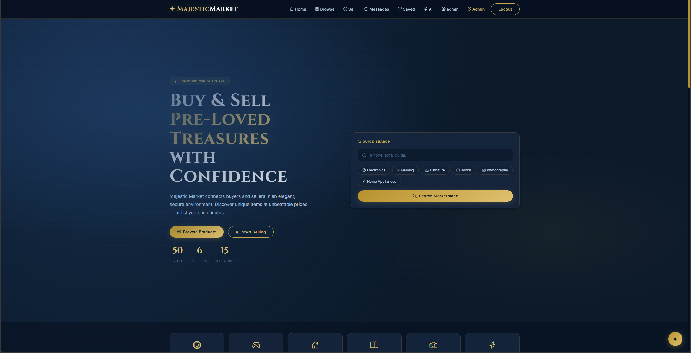
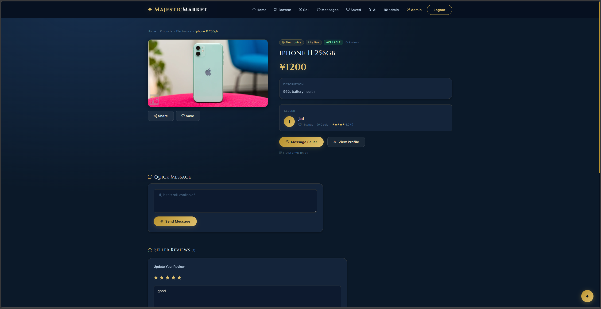
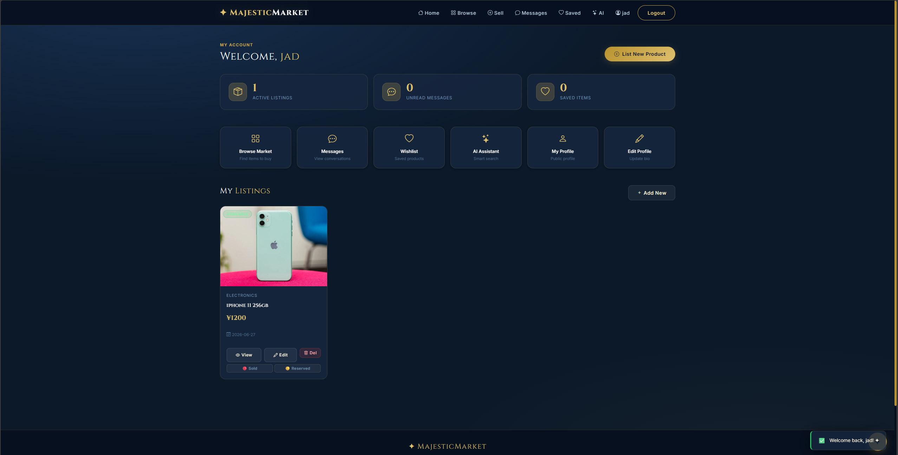
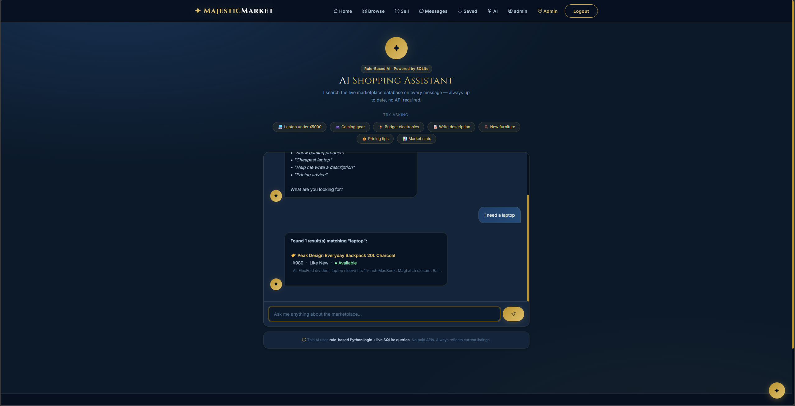
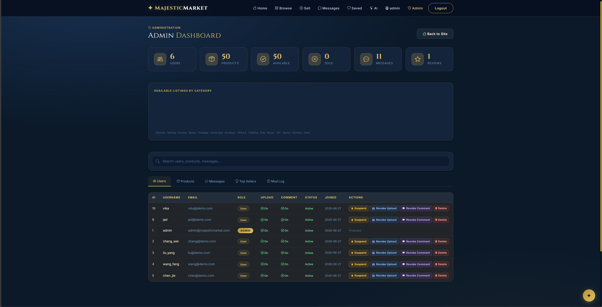

# ✨ MajesticMarket

### A smarter way to buy, sell, and discover.

**MajesticMarket** is a full-stack second-hand marketplace built with Python and Flask. It provides a platform where users can discover products, publish listings, communicate with sellers, manage their profiles, and receive assistance from an integrated rule-based shopping assistant.

<div align="center">


</div>

---

## 📖 Overview

MajesticMarket was developed to demonstrate how a modern online marketplace can be built using a lightweight Python backend and a responsive web interface.

The platform brings buyers and sellers together through product discovery, user-generated listings, integrated messaging, personalized profiles, and marketplace management tools.

It also incorporates a rule-based AI shopping assistant that interacts with the marketplace database to provide product recommendations and purchasing guidance without requiring a paid external AI API.

## ✨ Key Features

### 🛍️ Marketplace & Product Discovery
- Browse and search second-hand products.
- Explore products across multiple categories.
- Filter products according to relevant criteria.
- View detailed product descriptions, images, prices, and conditions.
- Track product availability and listing views.

### 👤 User Accounts & Profiles
- User registration and authentication.
- Secure password hashing using Werkzeug.
- Personalized user dashboards.
- Public seller profiles.
- Profile editing and biography management.
- Recently viewed products.
- Personal favorites and saved listings.

### 💬 Buyer-Seller Communication
- Direct messaging between buyers and sellers.
- Individual conversation threads.
- Message inbox and read-status tracking.
- Product-related communication.

### ⭐ Reviews & Ratings
- Rate sellers using a five-star rating system.
- Submit written reviews.
- Display seller feedback and ratings.
- Associate reviews with marketplace transactions and products.

### 🤖 AI Shopping Assistant
An integrated rule-based assistant built directly into the Flask application.

**Capabilities include:**
- Product searches based on budget.
- Category-based product discovery.
- Product description generation assistance.
- Buying and selling guidance.
- Pricing recommendations.
- Marketplace statistics.

The assistant uses Python keyword-matching logic and SQLite database queries rather than an external paid AI API.

### 🛡️ Administration & Moderation
- Dedicated administrator dashboard.
- User management and moderation.
- Account suspension controls.
- Upload and commenting permissions.
- Product and marketplace management.
- Moderation activity logs.

---

## 🚀 Getting Started

### Prerequisites

- Python 3.10 or newer.
- pip package manager.
- A modern web browser.

### 1. Clone the repository

```bash
git clone https://github.com/xJAR4B/MajesticMarket.git
cd MajesticMarket
```

### 2. Create a virtual environment

**Windows:**

```powershell
python -m venv venv
venv\Scripts\activate
```

**macOS / Linux:**

```bash
python3 -m venv venv
source venv/bin/activate
```

### 3. Install dependencies

```bash
pip install -r requirements.txt
```

### 4. Launch the application

```bash
python app.py
```

### 5. Access the marketplace

Open your browser and navigate to:

```text
http://127.0.0.1:5000
```

The SQLite database is initialized by the application, with marketplace categories and demonstration data seeded when appropriate.

---

## 🏗️ Architecture & Project Structure

```text
MajesticMarket/
│
├── app.py
│   └── Flask application, routes, authentication,
│       database operations and AI assistant
│
├── database.db
│   └── SQLite database
│
├── requirements.txt
│   └── Python dependencies
│
├── templates/
│   ├── base.html
│   ├── index.html
│   ├── login.html
│   ├── register.html
│   ├── dashboard.html
│   ├── products.html
│   ├── product_details.html
│   ├── new_product.html
│   ├── edit_product.html
│   ├── profile.html
│   ├── edit_profile.html
│   ├── favorites.html
│   ├── messages.html
│   ├── conversation.html
│   ├── ai_assistant.html
│   └── admin.html
│
└── static/
    ├── css/
    │   └── style.css
    │
    ├── js/
    │   └── script.js
    │
    └── uploads/
        └── Product images
```

## 🗄️ Database Design

MajesticMarket uses SQLite as its relational database.

| Table | Responsibility |
|---|---|
| `users` | User accounts, authentication and permissions |
| `products` | Marketplace listings and product information |
| `categories` | Product categorization |
| `messages` | Buyer-seller conversations |
| `favorites` | Saved products |
| `reviews` | Seller ratings and feedback |
| `mod_logs` | Administrative moderation records |
| `recently_viewed` | User browsing history |

Relationships between users, products, messages, and reviews are maintained through database foreign keys.

## 🛠️ Technology Stack

| Component | Technology |
|---|---|
| Backend | Python |
| Web framework | Flask 3.0.3 |
| Database | SQLite |
| Frontend | HTML5, CSS3, JavaScript |
| UI framework | Bootstrap 5 |
| Templating | Jinja2 |
| Authentication | Flask Sessions |
| Password security | Werkzeug |
| AI functionality | Rule-based Python logic |

## 🔐 Security Notes

This repository is an educational and development project.

Before deploying it publicly:
- Replace the hardcoded Flask secret key with an environment variable.
- Change or remove default administrator credentials.
- Never expose real user credentials or database contents.
- Configure production-grade session security.
- Use a production WSGI server and appropriate deployment settings.

## 🎯 Project Goals

MajesticMarket explores the development of a full-stack web application, bringing together:

- Backend application development.
- Relational database design.
- User authentication and authorization.
- Frontend development and responsive interfaces.
- Real-time-style user communication.
- Rule-based intelligent assistance.
- Administrative controls and moderation.

---

## 📸 Screenshots

### Homepage


### Product Details


### User Dashboard


### Messaging


### AI Shopping Assistant


### Admin Dashboard


---

<div align="center">

### Built with Python, creativity, and ambition.

**MajesticMarket**

[View Repository](https://github.com/xJAR4B/MajesticMarket)

⭐ If you find this project interesting, consider giving it a star.

</div>

